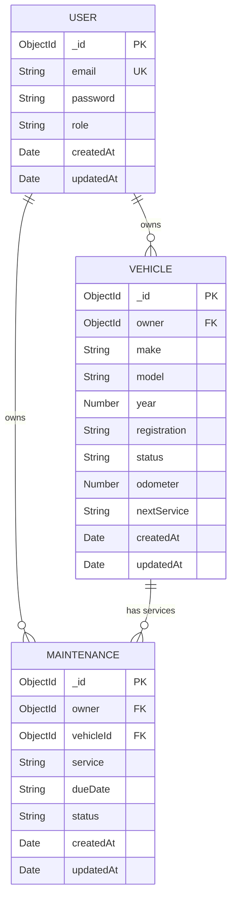
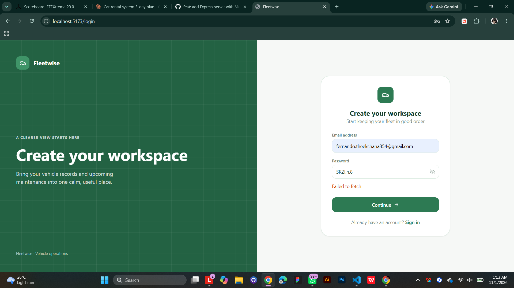
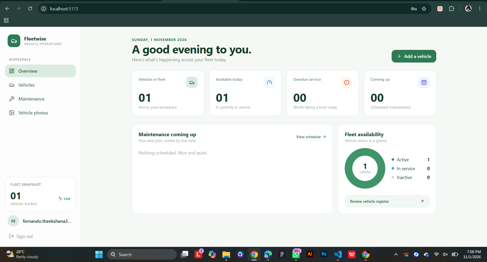
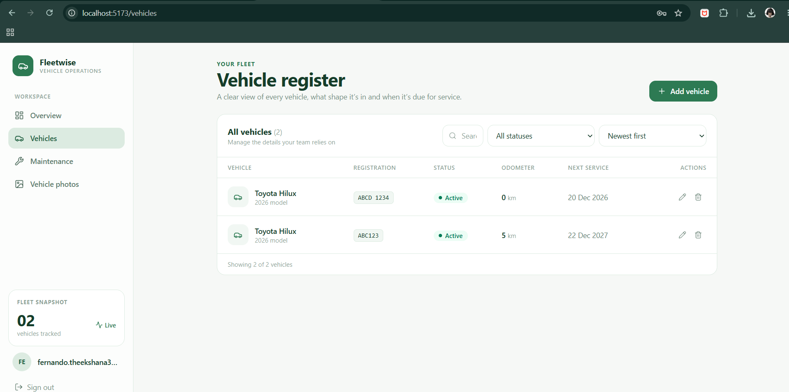
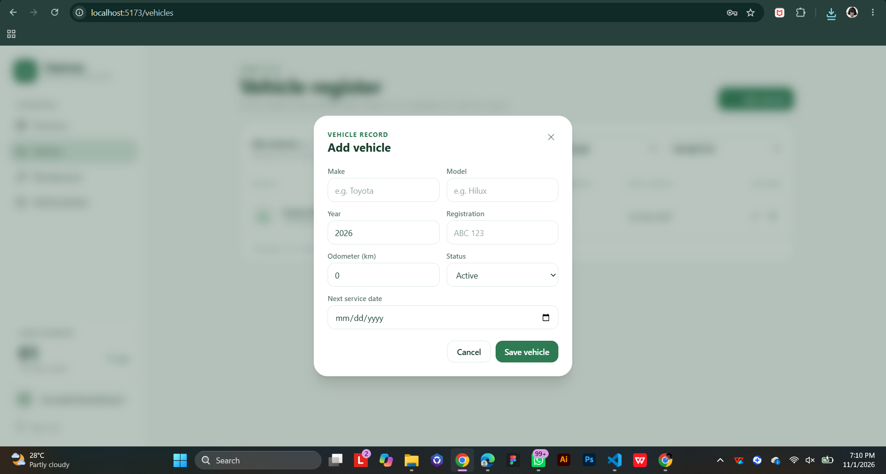
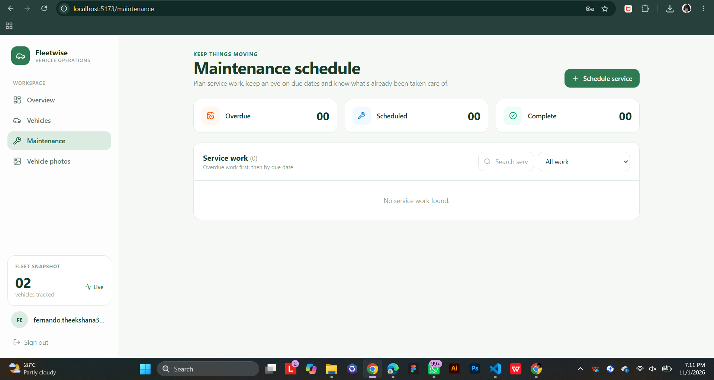
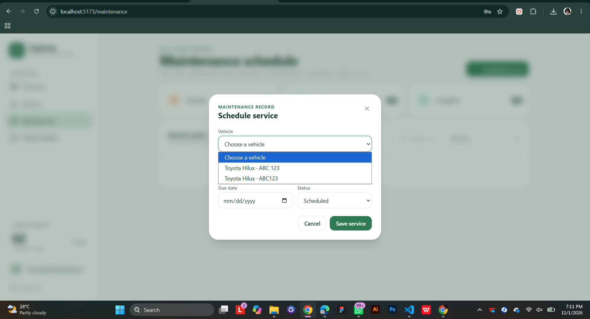
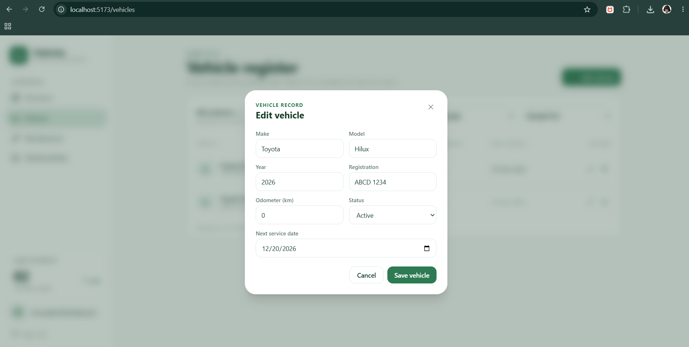
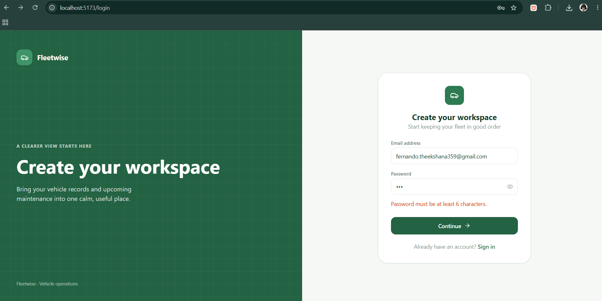

# Fleetwise – Vehicle Operations Manager

A full-stack web application for keeping track of a vehicle fleet and its maintenance schedule.
Each user registers, logs in, and manages **their own** vehicles and service jobs. All data is stored in MongoDB.

> > **Module:** EC4307 Web Application Development – Mini Project
> **Student:** FERNANDO L.N.T.
> **Index number:** EG/2023/5593

---

## Features

| Area | What it does |
|------|--------------|
| **Authentication** | Register and log in with email and password. Passwords are hashed with bcrypt, and sessions use JWT tokens. |
| **Create** | Add vehicles and schedule maintenance services through forms. |
| **Read** | Vehicle register and maintenance schedule, with **search**, **status filter** and **sort**. Overview dashboard with live counts. |
| **Update** | Edit a vehicle or a service, and mark a service as complete. |
| **Delete** | Delete a vehicle (its services are deleted with it) or a service. |
| **Validation** | Client-side checks (required fields, email format, password length, year and odometer limits) and server-side checks (schema rules, ownership checks, clear error messages). |
| **Responsive UI** | Built with Tailwind CSS and a sidebar layout. |

**Main entity:** Vehicle (full CRUD). **Second entity:** Maintenance (full CRUD, linked to Vehicle).

---

## Tech stack

- **Frontend:** React 19, Vite, React Router, Tailwind CSS
- **Backend:** Node.js, Express 5, Mongoose
- **Database:** MongoDB Atlas
- **Auth:** JSON Web Tokens and bcryptjs
- **Version control:** Git and GitHub, with feature branches and pull requests (`feature/*` → `dev` → `main`)

---

## Setup

### Requirements
- Node.js 18 or newer
- A MongoDB Atlas cluster (or a local MongoDB)

### 1. Backend

```bash
cd Server
npm install
```

Create a file `Server/.env` with:

```
PORT=5000
MONGO_URI=<your MongoDB connection string>
JWT_SECRET=<any long random string>
```

Start the server:

```bash
npm run dev
```

The API runs at `http://localhost:5000`.

### 2. Frontend

Open a second terminal:

```bash
cd Client
npm install
npm run dev
```

Open `http://localhost:5173`, register an account and start adding vehicles.

---

## Database design (ERD)



Deleting a vehicle also deletes its maintenance records. Each user can only see and change their own records.

---

## API endpoints

All routes except `/api/auth/*` need the header `Authorization: Bearer <token>`.

| Method | Endpoint | Purpose |
|--------|----------|---------|
| POST | `/api/auth/register` | Create an account |
| POST | `/api/auth/login` | Log in and receive a token |
| GET | `/api/vehicles` | List my vehicles |
| POST | `/api/vehicles` | Add a vehicle |
| PUT | `/api/vehicles/:id` | Update a vehicle |
| DELETE | `/api/vehicles/:id` | Delete a vehicle (and its services) |
| GET | `/api/maintenance` | List my services |
| POST | `/api/maintenance` | Schedule a service |
| PUT | `/api/maintenance/:id` | Update a service / mark complete |
| DELETE | `/api/maintenance/:id` | Delete a service |

---

## Screenshots

| | |
|---|---|
|  |  |
|  |  |
|  |  |
|  |  |

---

## Known limitations

- The **Vehicle photos** page keeps images in the browser only. They are not saved to the database and disappear on refresh. The main entities (vehicles and maintenance) are fully persistent.
- There is no password reset or email verification.